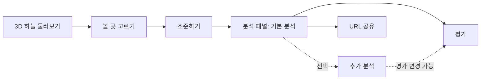
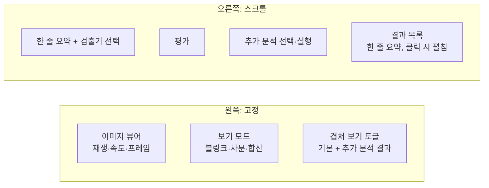
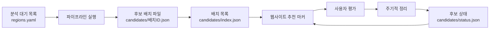
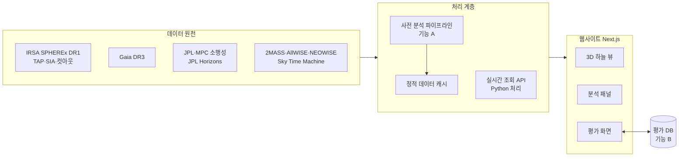

# HEIMDALLR 기획서 (Planet X and SPHEREx)

> NASA Space Apps Challenge 2026 · Seoul · 내부 기획 문서 (한국어)
> 최종 갱신: 2026-11-14
> 이 문서가 팀의 기준 기획이다.
> 방향성·마일스톤은 [`memory/`](memory/), 결정 기록은 [`decisions.md`](decisions.md), 영어 제출물 원고는 [`submission/`](submission/)에서 관리한다.
> 이 문서는 AI 도구(Claude)의 도움을 받아 작성했다. 아직 정하지 않은 항목은 [14장 결정 필요 사항](#14-결정-필요-사항)에 모아 두었다.

## 목차

1. [개요](#1-개요)
2. [챌린지 요구사항 매핑](#2-챌린지-요구사항-매핑)
3. [사용자 시나리오](#3-사용자-시나리오)
4. [기본 분석: 좌표 처리 파이프라인](#4-기본-분석-좌표-처리-파이프라인)
5. [분석 패널 UX](#5-분석-패널-ux)
6. [추가 분석](#6-추가-분석)
7. [기능 A: 움직임 후보 추천](#7-기능-a-움직임-후보-추천)
8. [기능 B: 사용자 평가](#8-기능-b-사용자-평가)
9. [시스템 구조와 데이터 계약](#9-시스템-구조와-데이터-계약)
10. [일정과 역할](#10-일정과-역할)
11. [리스크와 대응](#11-리스크와-대응)
12. [제출물 계획](#12-제출물-계획)
13. [참고 자료](#13-참고-자료)
14. [결정 필요 사항](#14-결정-필요-사항)

---

## 1. 개요

누구나 3D 하늘을 둘러보다 한 지점을 클릭하면, 그 자리의 SPHEREx 이미지가 블링크로 재생되고 움직이는 천체를 함께 찾고 검증할 수 있는 공개 웹 도구를 만든다.

- **한 줄 콘셉트:** 기계가 후보를 찾고, 사람이 확인하는 SPHEREx 블링크 관측소
- **대상 사용자:** 천문에 관심 있는 일반인·학생(1순위), 시민과학 참여자(2순위), 연구자의 빠른 확인(3순위)
- **해결할 문제:** SPHEREx는 6개월마다 전천을 102개 밴드로 관측해 10억 개 이상의 천체 이미지를 쌓고 있지만, 한 사람이나 코드 하나로는 다 살펴볼 수 없다.
- **하지 않는 주장:** Planet X 발견, 자동 분류 정확도는 성과로 내세우지 않는다. 결과는 항상 "후보"로 표시한다.

### 블링크 원리

같은 하늘을 시간 차이를 두고 찍은 이미지를 번갈아 보면, 고정된 별은 그대로 있고 움직인 천체만 자리를 옮긴다. 나중 이미지에서 이전 이미지를 빼면(차분) 고정된 별은 지워지고 움직인 천체만 남는다. 명왕성도 1930년 이 방식으로 발견됐다.

### 좌표에 대한 전제

- 적경·적위(RA/Dec)는 천구에 고정된 좌표다(ICRS 기준). 같은 좌표는 언제 보든 같은 하늘 지점이다.
- 별·은하는 배경으로 고정되고, 가까운 별은 조금씩, 소행성·혜성은 크게 움직인다. 이 차이를 보는 것이 블링크다.
- **움직이는 천체의 좌표는 항상 관측 시점과 함께 저장한다.** 소행성 후보는 6개월 뒤 같은 좌표에 없다.

---

## 2. 챌린지 요구사항 매핑

필수 6개는 MVP에서 모두 충족하고, 선택 8개도 모두 기능으로 연결한다.

| 구분 | 챌린지 요구사항 | 우리 기능 | 단계 |
| --- | --- | --- | --- |
| 필수 | 공개 웹 도구 | 로그인 없는 공개 웹사이트 | MVP |
| 필수 | SPHEREx 이미지 표시 | IRSA DR1 컷아웃 표시 | MVP |
| 필수 | RA/Dec 좌표 입력 | 검색창 입력 + 3D 하늘 클릭 | MVP |
| 필수 | 이미지를 짧은 영상처럼 재생 | 블링크 뷰어 | MVP |
| 필수 | 움직이는 천체를 쉽게 발견 | 차분 보기, Gaia 예측 위치 | MVP |
| 필수 | 테스트 대상 5개 검증 | 대상 핀 + 사전 캐시 + 검증 결과 표 | MVP |
| 선택 1 | 새 데이터 릴리스 쉽게 반영 | 릴리스를 설정값으로 분리, 기본 DR1 | MVP |
| 선택 2 | 102개 밴드 활용, 스펙트럼 | 검출기별 보기(D1–D6), Comet Breath의 분자 밴드 비교 | MVP / 확장 |
| 선택 3 | 시점별 이미지 더하기·빼기 | 차분·합산 모드 | MVP |
| 선택 4 | 시야 크기 선택 | 시야 슬라이더 | MVP |
| 선택 5 | Gaia·WISE 오버레이 | Gaia DR3 고유운동 예측 위치 | MVP |
| 선택 6 | URL로 좌표 조회·임베드 | `?ra=&dec=&fov=&mode=&det=` | MVP |
| 선택 7 | 메타데이터·오염 플래그 표시 | 관측 정보 패널 | MVP |
| 선택 8 | Astropy·Aladin 등 공개 도구 | astropy, astroquery | MVP |

테스트 대상: Barnard's Star, Epsilon Indi B, WISE 0855 (RA 08h55m10.831s, Dec −07°14′42.53″), RW Aurigae, R Draconis.

---

## 3. 사용자 시나리오

1. **하늘 둘러보기:** 천구 중심의 1인칭 시점(지평선 없음). 커서 위치의 RA/Dec 실시간 표시.
2. **볼 곳 고르기:** 테스트 대상 5개 핀, 움직임 후보 마커(기능 A), 평가가 많은 지점이 하늘에 표시된다. 핀 클릭 또는 좌표·천체 이름 검색으로 카메라 이동.
3. **조준하기:** 일정 배율 이상 확대하면 커서가 컷아웃 크기의 사각 조준선으로 바뀌고, 그 지점의 SPHEREx 관측 횟수를 표시한다.
4. **분석하기:** 클릭하거나 좌표를 입력하면 분석 패널이 열린다(4장, 5장).
5. **평가하기:** 추가 분석 없이도 평가할 수 있다. 평가 전에는 다른 사람의 평가를 볼 수 없다(8장).
6. **공유하기:** 좌표·시야·모드·검출기가 URL에 반영된다.

용어 주의: 클릭했을 때 나오는 것은 별자리 전체가 아니라 그 지점의 작은 영역(수 분각) 컷아웃이다.

---

## 4. 기본 분석: 좌표 처리 파이프라인

사용자가 좌표를 입력하거나 하늘을 클릭하면 서버가 아래 순서로 처리한다. 이 결과가 분석 패널의 기본 화면이 된다.

| 단계 | 처리 | 핵심 판단 |
| --- | --- | --- |
| 1. 입력 검증 | RA/Dec(10진수·60진수) 또는 천체 이름을 좌표로 변환, 시야 확인 | 형식·범위 오류 즉시 안내 |
| 2. 관측 검색 | IRSA에서 그 지점을 포함한 SPHEREx 이미지 조회 (DR1 우선, 없으면 QR3) | 0건이면 "관측 없음" |
| 3. 파장 맞추기 | 이미지마다 그 좌표 픽셀의 실제 파장 계산, 같은 검출기·비슷한 파장끼리 묶기 | LVF 특성상 가장 중요 |
| 4. 컷아웃·정렬 | IRSA 컷아웃으로 작은 영역만 받아 **입력 좌표 기준 고정 하늘 격자**에 재투영 | 천체 중심 정렬 금지 (움직임이 사라짐) |
| 5. 품질 거르기 | 플래그·불량 픽셀 마스킹, 목표 영역 오염 프레임 제외 | 제외 이유 기록 |
| 6. 시점 묶기 | 관측 날짜로 방문(약 6개월 간격) 구분, 같은 방문 안의 프레임 합산 | 방문 1회면 비교 불가 |
| 7. 결과 생성 | 방문별 블링크 프레임, 첫 방문 대비 차분, 전체 합산 | PNG + 메타데이터 JSON |
| 8. 주석 | Gaia DR3 별을 각 관측 날짜 위치로 이동해 표시, 그 시점 시야 안의 알려진 소행성 표시, 기능 A 후보 마커 | 알려진 것과 모르는 것 구분 |

### 결과 상태

| 상태 | 조건 | 제공 |
| --- | --- | --- |
| 비교 가능 | 방문 2회 이상 | 블링크·차분·합산, 평가 |
| 비교 불가 | 방문 1회 | 이미지 1장, "다음 관측 후 비교 가능" 안내, 평가 숨김 |
| 관측 없음 | 0건 또는 미공개 | 안내, 가까운 관측 지점·테스트 대상 바로가기 |
| 처리 중 | 처음 요청한 좌표 | 단계 표시 (관측 찾기 → 컷아웃 → 파장 맞추기 → 정렬) |
| 오류 | 외부 서비스 실패 등 | 실패 이유, 다시 시도 |

### 기본값

| 항목 | 기본값 | 비고 |
| --- | --- | --- |
| 데이터 릴리스 | DR1 (없으면 QR3) | 설정값으로 분리, QR2 경로 사용 안 함 |
| 시야 | 3′ × 3′ | 1′–10′ 조절 · **팀 확정 필요** |
| 검출기 | 그 좌표에서 관측 횟수가 가장 많은 검출기 자동 선택 | 사용자가 D1–D6 전환 · **팀 확정 필요** |
| 파장 일치 허용치 | 미정 | 실제 자료로 정하고 이 문서에 기록 |

### 정확한 비교를 위한 원칙

- 이동 비교는 항상 고정 하늘 격자에서 한다. 목표 천체를 매번 중앙에 맞추지 않는다.
- 같은 검출기라도 목표 픽셀의 파장이 다를 수 있으므로 중심 파장·대역폭을 확인한다.
- 화면용 PNG의 자동 대비 차이를 밝기 변화로 해석하지 않는다. 정량 비교는 수치 데이터로 한다.
- 비교 가능한 관측이 부족하면 시점이나 파장을 임의로 만들어 채우지 않는다.
- 캐시된 시연 데이터는 "실제 관측 캐시"임을 표시하고 임의 좌표 검색과 구분한다.

### 속도

- 후보 좌표·테스트 대상은 미리 처리해 저장하고, 임의 좌표는 실시간으로 처리한 뒤 캐시한다 (9장 데이터 관리).
- 처음 요청하는 좌표는 비동기로 처리하고 진행 단계를 화면에 보여준다.

---

## 5. 분석 패널 UX

### 레이아웃

- **데스크톱:** 왼쪽 이미지 뷰어 고정, 오른쪽 패널만 스크롤. 어떤 결과를 보든 이미지가 옆에 있다.
- **좁은 화면:** 한 열로 바뀐다.
- **모바일:** 이미지를 상단에 작게 고정, 나머지는 아래에서 끌어올리는 시트.

### 기본 화면 (항상 표시)

1. **한 줄 요약:** 관측 횟수, 기간, 검출기·파장 (예: "4 visits · 2025-05 → 2026-11 · D2 1.1–1.6 μm")
2. **이미지 뷰어:** 재생/정지, 속도, 프레임 슬라이더, 확대
3. **보기 모드:** 블링크 / 차분 / 합산
4. **검출기 선택:** D1–D6 칩, 파장 범위와 관측 횟수 표시
5. **겹쳐 보기:** Gaia 예측 위치, 알려진 소행성, 움직임 후보 (추가 분석 결과가 생기면 토글이 늘어남)
6. **관측 정보:** 날짜, 목표 픽셀 파장, 품질 플래그, IRSA 원본 링크
7. **공유:** 현재 상태를 담은 URL 복사

### 평가 위치

평가는 오른쪽 패널에서 추가 분석보다 위에 둔다. "추가 분석 없이도 평가 가능" 표시를 붙이고, 추가 분석 결과를 본 뒤 평가를 바꿀 수 있다.

### 추가 분석 영역 (선택)

- 체크박스로 원하는 분석만 고르거나 "전체 선택" 후 실행한다.
- 실행 버튼 문구는 선택에 따라 바뀐다 ("Run 3" / "Run all"). 예상 소요 시간을 함께 표시한다.
- 조건(최소 관측 횟수 등)이 맞지 않는 분석은 비활성화하고 이유를 보여준다.
- 결과는 끝나는 순서대로 **한 줄 요약**으로 쌓이고, 클릭하면 그 자리에서 펼쳐진다. 한 번에 하나만 펼친다.
- 결과는 그 좌표에 저장해 다음 방문자도 바로 볼 수 있다.
- 결과가 없을 때도 탐지 한계와 함께 솔직하게 표시한다.
- 결과는 출력 종류에 따라 보여주는 자리가 다르다.

| 출력 종류 | 보여주는 곳 | 예 |
| --- | --- | --- |
| `overlay` | 왼쪽 이미지 위 겹쳐 보기 토글로 추가, 펼치면 강조 | Fake Planet Lab 오탐 레이어 |
| `chart`, `text` | 오른쪽 결과 줄을 펼친 자리 | 체크리스트, 그래프 |
| `audio` | 결과 줄 안의 재생 컨트롤, 재생 위치를 이미지에 동기화 | Sky Sonata |
| `view` | 왼쪽 뷰어를 해당 모드로 전환 (돌아가기 버튼 제공) | Sky Time Machine 연도 슬라이더, Neighborhood in Motion 3D 보기 |

---

## 6. 추가 분석

기법 목록과 각 기법의 상세는 [`analyses/README.md`](analyses/README.md)에서 관리한다.

### 확정된 기법

| 기법 | 한 줄 설명 | 화면 배치 |
| --- | --- | --- |
| [Sky Time Machine](analyses/sky-time-machine.md) | 2MASS부터 SPHEREx까지 25년 적외선 하늘을 한 슬라이더로 비교 | 추가 분석 목록 |
| [Fake Planet Lab](analyses/fake-planet-lab.md) | 우주선 흔적·유령상·포화·잔상을 레이어로 보여주는 오탐 판별 | 추가 분석 목록 |
| [Neighborhood in Motion](analyses/neighborhood-in-motion.md) | 근접 천체를 3D 공간에서 수천 년 앞뒤로 이동 | 추가 분석 목록 (조건부) |
| [Sky Sonata](analyses/sky-sonata.md) | 하늘의 변화를 소리로 듣는 접근성 도구 | 추가 분석 목록 |
| [Blink Arena](analyses/blink-arena.md) | 가짜 천체를 섞은 시민과학 판정 게임 | 별도 화면 권장 · **배치 논의 필요** |
| [Comet Breath](analyses/comet-breath.md) | 성간 혜성 3I/ATLAS의 시기별 분자 방출 비교 | 특별 대상 페이지 권장 · **배치 논의 필요** |

아래 공통 규칙을 지키면 UX(5장)와 시스템(9장)을 크게 고치지 않고 기법을 추가할 수 있다.

### 공통 규칙

| 항목 | 규칙 |
| --- | --- |
| 입력 | 기본 분석 결과(정렬된 컷아웃, 방문 목록, 메타데이터)를 입력으로 받는다. 외부 데이터가 필요하면 출처를 명시한다 |
| 실행 조건 | 최소 방문 횟수와 **적용 대상**(모든 좌표 / 특정 대상만)을 명시한다. 조건이 안 맞으면 UI에서 비활성화하고 이유를 보여준다 |
| 화면 배치 | 기본은 추가 분석 목록. 좌표 하나에 대한 분석이 아니면 별도 화면이나 특별 대상 페이지로 둔다 |
| 출력 종류 | `overlay`(이미지 위 표시), `chart`(그래프), `text`(판정 문장), `audio`(소리), `view`(뷰어 모드 전환·별도 화면) 중 하나 이상 |
| 한 줄 요약 | 결과 목록에 표시할 한 문장을 반드시 만든다 (예: "8.0″/yr · Gaia와 일치") |
| 판정 표시 | 필요하면 `ok`/`warn`/`none` 중 하나를 붙인다 |
| 결과 없음 | 아무것도 못 찾았을 때도 탐지 한계와 함께 결과를 만든다 |
| 예상 시간 | 대략적인 소요 시간을 적는다 (UI 표시용) |
| 캐시 | 결과는 (좌표, 시야, 릴리스, 검출기, 분석 ID, 분석 버전) 단위로 저장한다 |

### 새 분석 추가 절차

1. `analyses/_template.md`를 복사해 `analyses/<분석-id>.md`로 만든다.
2. 템플릿을 채운다.
3. `analyses/README.md`의 목록 표에 한 줄 추가한다.
4. 상태를 `조사 중` → `확정` → `구현 중` → `완료`로 갱신한다.

---

## 7. 기능 A: 움직임 후보 추천

사전 분석으로 찾은 "움직임 후보"를 하늘에 마커로 표시해, 처음 온 사용자가 어디를 봐야 할지 알게 한다. **전천 분석은 불가능하므로 분석하면서 점점 늘려가는 구조**로 만든다.

- **표시 문구는 "움직임 후보"로 한다.** "감지된 좌표"는 확정처럼 읽힌다.
- 후보마다 알려진 소행성 목록과 대조해 "알려진 소행성"과 "미확인 후보"로 구분한다.
- 후보마다 탐지된 시점 수, 신호 대 잡음비 같은 신뢰도를 함께 보여준다.

### 점점 늘려가는 구조

- **분석 대기 목록 (`regions.yaml`):** 분석할 영역(중심 좌표, 크기, 릴리스)과 상태(대기/완료/실패). 개발자는 한 줄만 추가하면 된다.
- **파이프라인 실행:** 대기 중인 영역을 몇 개씩 분석한다. 대회 중에는 수동 실행, 이후에는 GitHub Actions 예약 실행.
- **후보 배치 파일:** 실행 한 번에 파일 하나. 한 번 만든 파일은 고치지 않는다. 실행 날짜, 릴리스, 파이프라인 버전을 기록한다.
- **배치 목록:** 웹사이트는 이 목록만 읽는다. 배치를 추가하면 다음 배포부터 마커가 늘어난다.
- **후보 ID:** 릴리스와 좌표로 만드는 고정 ID. 같은 위치가 다른 배치에서 다시 잡혀도 하나로 합쳐지고, 평가도 이 ID에 붙는다.
- **후보 항목:** 후보 ID, RA/Dec, **관측 시점**, 탐지된 시점 수, 검출기·파장, 신호 대 잡음비, 알려진 소행성 일치 여부, 배치 ID.

### 주기적 정리 규칙

정해진 주기(예: 하루 1회)마다 정리 작업이 평가를 집계해 `candidates/status.json`에 상태를 적는다. 배치 파일은 건드리지 않는다.

| 상태 | 조건 (`config.yaml`에서 조정) | 표시 |
| --- | --- | --- |
| 평가 부족 | 평가 5건 미만 | 추천 유지, "평가 부족" 표시 |
| 추천 유지 | 평가 5건 이상, "움직인다" 30% 이상 | 추천 마커 |
| 추천 제외 | 평가 5건 이상, "움직인다" 30% 미만 또는 "잡음·결함" 50% 이상 | 마커에서 빠짐 |
| 주목할 후보 | 평가 10건 이상, "움직인다" 70% 이상, 미확인 천체 | 강조 마커 |

- 숫자는 출발점이다. 코드 수정 없이 `config.yaml`에서 바꾼다.
- **추천 제외는 삭제가 아니다.** 좌표를 직접 입력하면 여전히 보고 평가할 수 있다.
- 상태 변경은 날짜와 이유를 기록하고, 새 릴리스가 나오면 제외된 후보도 다시 분석할 수 있게 한다.
- 해커톤 범위: 배치 목록 구조와 정리 스크립트를 만들고 수동으로 한 번 실행한다. 예약 실행은 README에 다음 단계로 적는다.

---

## 8. 기능 B: 사용자 평가

- **3지선다:** "움직인다" / "안 움직인다" / "잡음·결함" (화면 문구: `Moving` / `Not moving` / `Noise or artifact`, [용어집](memory/glossary.md))
- **평가 전에는 다른 사람의 평가를 숨긴다.** 평가 후 평가 수와 비율을 공개한다. 쏠림을 막기 위해서다.
- 추가 분석 없이도 평가할 수 있고, 나중에 평가를 바꿀 수 있다.
- 지점별 평가 수와 "움직인다" 비율을 표시하고, 5건 미만이면 "평가 부족"으로 표시한다.
- 집계 아래에 "합의도이지 확정된 발견이 아님"을 표시한다.
- **익명 저장.** 이름·이메일을 받지 않는다. 브라우저당 1회 제한 정도로 두고, 한계를 README에 적는다.
- 데모 시점의 평가는 팀원 평가로 채우고 "팀 테스트 데이터"로 표시한다.
- 비교 불가(방문 1회) 상태에서는 평가를 받지 않는다.
- Blink Arena(판정 게임)의 판정도 같은 3지선다라서 같은 평가 DB에 저장한다. 합성 카드 판정은 실제 후보 집계와 분리한다.

---

## 9. 시스템 구조와 데이터 계약

- **웹:** Next.js 16 App Router, React 19, TypeScript, Tailwind CSS 4, shadcn/ui, TanStack Query (레포 기본 구성). `main` 푸시 시 Vercel 프로덕션 배포. 코딩 규칙은 루트 `AGENTS.md`
- **3D:** Three.js 또는 Unity WebGL (**팀 결정 필요**, 3D 하늘 뷰와 Neighborhood in Motion이 같은 엔진을 쓰는 것이 좋음). 블링크는 canvas, 소리는 Web Audio
- **천문 데이터 처리:** Python (astropy, astroquery 또는 PyVO, numpy, reproject). 실시간 처리를 별도 Python API(FastAPI 등)로 둘지, 사전 처리만 Python으로 하고 웹은 Next.js Route Handler로 둘지 **팀 결정 필요**
- **평가 저장:** 익명 키-값 DB (Supabase, Firebase 등 무료 등급 · **팀 결정 필요**)
- 무거운 처리는 미리 돌려 정적 파일로 두고, 웹은 보여주기만 한다. 평가만 서버에 저장한다.

### 프레임 데이터 계약 (API 응답)

프론트와 데이터 처리를 독립적으로 진행하기 위해 프레임별 필드를 먼저 합의한다.

| 필드 | 설명 |
| --- | --- |
| `observation_id` | IRSA 관측 ID |
| `observed_at` | 관측 시각 (UTC, ISO 8601) |
| `visit` | 방문 번호 (4장 6단계 시점 묶기 결과) |
| `ra_deg`, `dec_deg` | 컷아웃 중심 좌표 |
| `fov_arcmin` | 시야 |
| `detector` | 검출기 (1–6) |
| `wavelength_um`, `bandwidth_um` | 목표 픽셀의 중심 파장과 대역폭 |
| `release` | 데이터 릴리스 (DR1, QR3) |
| `image_url` | 화면용 이미지 |
| `quality` | 품질 플래그 요약 |
| `source_url` | IRSA 원본 파일 링크 |
| `processing_version` | 처리 버전 |

응답 전체에는 결과 상태(4장), 겹쳐 보기 데이터(Gaia·소행성·후보), 사용 가능한 추가 분석 목록을 함께 담는다.

### 데이터 관리

대부분의 좌표는 요청이 올 때 IRSA 등에서 실시간으로 받아오고, 우리가 추천하는 좌표만 미리 처리해 저장한다. 원본 FITS는 저장하지 않고 IRSA 링크(`source_url`)로 남긴다.

| 계층 | 대상 | 방식 | 보관 |
| --- | --- | --- | --- |
| 사전 저장 | 기능 A 후보 좌표, 테스트 대상 5개, 특별 대상(3I/ATLAS) | 파이프라인이 미리 처리해 저장 | 영구 (새 릴리스가 나오면 재생성) |
| 실시간 + 캐시 | 사용자가 입력하거나 클릭한 임의 좌표 | 요청 시 IRSA에서 받아 처리, 결과를 캐시 | 일정 기간 또는 용량 한도 (오래된 것부터 삭제) |
| 사용자 데이터 | 평가 | 평가 DB에 익명 저장 | 영구 |
| 설정·목록 | `regions.yaml`, `candidates/index.json`, `candidates/status.json`, `config.yaml` | 레포에서 버전 관리 | 영구 |

#### 저장하는 것과 하지 않는 것

- **저장:** 화면용 이미지(방문 × 검출기), 프레임 메타데이터 JSON(위 데이터 계약), 겹쳐 보기 데이터, 추가 분석 결과
- **저장 안 함:** 원본 스펙트럼 이미지 FITS(수백 MB). 필요하면 IRSA에서 다시 받는다.
- **선택:** 정량 분석이 필요한 경우에만 작은 컷아웃 FITS를 함께 저장한다.

#### 사전 저장 대상의 규칙

- 사전 저장 좌표는 블링크·기본 분석 결과와 함께, 실행 시간이 긴 추가 분석 결과(예: Sky Time Machine)도 미리 만들어 둔다.
- 저장 단위 키: (후보 ID 또는 좌표, 시야, 릴리스, 처리 버전). 검출기 6개 결과를 모두 저장해 사용자가 전환해도 바로 보이게 한다.
- 새 데이터 릴리스가 나오면 기존 결과를 "이전 릴리스"로 표시하고 백그라운드에서 다시 만든다.
- 추천에서 제외된 후보(7장)의 저장 데이터는 바로 지우지 않는다. 좌표를 직접 입력하면 여전히 빠르게 열린다.

#### 실시간 + 캐시의 규칙

- 캐시 키: (반올림한 좌표, 시야, 릴리스, 검출기). 아주 가까운 좌표는 같은 결과를 재사용한다.
- 같은 좌표를 여러 사람이 동시에 요청하면 처리는 한 번만 하고 결과를 공유한다.
- (선택) 임의 좌표라도 조회와 평가가 많이 쌓이면 사전 저장 계층으로 올린다.

#### 저장 위치

- 이미지·결과 파일은 레포가 아니라 오브젝트 스토리지(예: S3, Cloudflare R2, Supabase Storage)에 두고, 레포에는 목록 JSON만 둔다. 이미지 파일을 git에 넣으면 레포가 빠르게 커진다.
- 해커톤 범위에서 후보가 수십 개 수준이면 정적 호스팅에 함께 올려도 된다. **저장소 서비스는 팀 결정 필요.**

#### 장애 대응

- IRSA가 느리거나 응답하지 않아도 사전 저장 계층은 그대로 동작한다. 데모는 사전 저장 좌표로 진행한다.
- 실시간 요청이 실패하면 실패 이유와 다시 시도 버튼을 보여주고, 가까운 사전 저장 좌표를 안내한다.

---

## 10. 일정과 역할

| 시간 (KST) | 단계 | 내용 |
| --- | --- | --- |
| 11/14 09–12 | 출발 | 방향·역할 확정, 팀 미팅 예약, 데이터 접근 확인 |
| 11/14 12–19 | MVP 제작 | 좌표 입력 → 블링크 패널, 3D 껍데기 병렬 진행 |
| **11/14 19:00** | **관문** | **블링크 동작 확인** |
| 11/14 19–24 | 검증 보강 | 테스트 대상 5개 캐시, 차분, Gaia 예측 위치 |
| 11/15 00–09 | 추가 기능 | 기능 A 소수 영역 후보 탐지, 기능 B 평가 DB 연결, 추가 분석 착수 |
| 11/15 09–15 | 통합 | 3D와 분석 패널 연결, 배포, URL 공유 |
| **11/15 15:00** | **관문** | **기능 동결** |
| 11/15 15–23:55 | 문서·제출 | 슬라이드 7장, README, 요약·상세 설명 |
| **11/15 23:55** | **관문** | **Submit for Judging 완료 확인** (공식 마감 23:59) |

체크인 5회 중 4회(토 11–12, 16–18, 19–22시 / 일 06–12, 15–20시)와 팀 미팅 1회는 팀원 전원이 각자 완료한다.

| 역할 | 담당 범위 | 담당자 |
| --- | --- | --- |
| 데이터·백엔드 | IRSA 조회, 컷아웃 정렬, 기능 A 파이프라인, API | |
| 프론트엔드·분석 패널 | 블링크·차분 뷰어, 관측 정보, URL 공유 | |
| 3D·평가 | 3D 하늘 뷰, 기능 B 평가 화면과 DB | |
| 추가 분석 | 기법별 구현, `analyses/` 문서 갱신 | |
| 기획·발표 | 테스트 대상 검증, 슬라이드, 제출 문서 | |

---

## 11. 리스크와 대응

| 리스크 | 대응 |
| --- | --- |
| 3D 개발이 길어져 분석 패널이 약해짐 | 분석 패널 먼저, 3D 병렬, 실패 시 2D 입력 화면으로 제출 |
| IRSA 응답 지연으로 데모 실패 | 테스트 대상·후보 영역 사전 캐시, 단계별 로딩 표시 |
| 데이터 확보가 3시간 이상 지연 | 자동 분석 제외, 공식 도구로 컷아웃 확보에 집중 |
| 별 이동량이 1픽셀 미만이라 안 보임 | 차분과 Gaia 예측 위치로 보완, 소행성 후보를 대표 데모로 사용 |
| 밝은 별 포화 | 플래그 표시, 검증 결과 표에 한계로 기록 |
| 가짜 후보 다수 | "후보"로 표시, 알려진 소행성 대조, 사람 평가로 거르기 |
| 평가 데이터 없음 | 팀 테스트 데이터로 채우고 명시 |
| 추가 분석 6개를 모두 구현하기 어려움 | 6장 공통 규칙대로 틀을 먼저 구현하고, 난이도 낮은 기법부터 추가. 미구현 기법은 "준비 중"으로 표시해 설계를 보여줌 |
| DR1이 클라우드 전용이라 컷아웃 서비스로 받을 수 없을 가능성 | 착수 직후 DR1 컷아웃 가능 여부 확인, 안 되면 QR3 컷아웃 또는 S3 직접 읽기로 전환 |
| 대회 전 작성 코드 사용 금지 규정 | 11/14 09:00 이후 작업만 커밋 |

---

## 12. 제출물 계획

- **High-Level Summary:** 영어 50–200단어
- **Project Demo:** 7장 슬라이드 (공개 링크 1개)
- **Final Project:** 배포된 웹사이트 + GitHub 레포 (README 포함)
- **Use of SI:** 사용한 AI 도구와 용도 기록, 생성 코드는 주석과 README에 표시 (이 기획 문서도 AI 도구로 작성을 도왔다)
- **Space Agency Data:** IRSA SPHEREx DR1(3I/ATLAS 전용 영상 포함), Gaia DR3, 2MASS·AllWISE·NEOWISE (추가 분석에서 사용)
- **References:** 데이터·도구·코드 출처와 라이선스, SPHEREx 감사 문구
- **라이선스:** MIT (레포 루트 [`LICENSE`](../LICENSE))
- 모든 링크는 로그아웃 상태에서 열리는지 확인한다.

---

## 13. 참고 자료

- [Planet X and SPHEREx 챌린지](https://www.spaceappschallenge.org/2026/challenges/planet-x-and-spherex/) ([지역 재게시본](https://hackathlone.com/challenges/planet-x-and-spherex))
- [IRSA SPHEREx](https://irsa.ipac.caltech.edu/Missions/spherex.html)
- [SPHEREx 튜토리얼 노트북](https://caltech-ipac.github.io/irsa-tutorials/spherex/)
- [SPHEREx 컷아웃 서비스](https://irsa.ipac.caltech.edu/data/SPHEREx/docs/cutout_tool.html)
- [SPHEREx 데이터 접근](https://caltech-ipac.github.io/spherex-archive-documentation/spherex-data-access/) · [데이터 제품](https://caltech-ipac.github.io/spherex-archive-documentation/spherex-data-products/) · [데이터 릴리스](https://caltech-ipac.github.io/spherex-archive-documentation/spherex-data-releases/)
- [WiseView](http://byw.tools/wiseview) (UX 참고 모델)
- [Gaia 미션 데이터 (MAST)](https://archive.stsci.edu/missions-and-data/gaia)
- 행사 안내: NASA Space Apps Seoul 2026 참가자 가이드 (D-Day 안내 자료)
- 추가 분석 선정: 팀 아이디어 쇼케이스 문서 "Planet X and SPHEREx 해커톤 프로젝트 아이디어 13선"

---

## 14. 결정 필요 사항

정해지면 [`decisions.md`](decisions.md)에 기록하고, 해당 장을 고친 뒤 이 목록에서 지운다 (한 커밋으로).

- [ ] 기본 시야 3′ × 3′ 확정 (4장)
- [ ] 기본 검출기 자동 선택 방식 확정 (4장)
- [ ] 파장 일치 허용치 (4장, 실제 자료로 결정)
- [ ] DR1 컷아웃 가능 여부 확인, 안 되면 QR3 또는 S3 직접 읽기 (4장, 11장)
- [ ] 3D 엔진: Three.js / Unity WebGL (9장)
- [ ] 실시간 처리 구조: 별도 Python API / Next.js Route Handler + 사전 처리 (9장)
- [ ] 평가 DB 서비스 (9장)
- [ ] 이미지·결과 저장소 서비스 (9장)
- [ ] Blink Arena 화면 배치: 별도 화면 진입점 여부 (6장)
- [ ] Comet Breath 화면 배치: 3I/ATLAS 특별 핀 여부 (6장)
- [ ] 추가 분석 6개의 구현 우선순위 (6장, 11장)
- [ ] 역할별 담당자 (10장)
