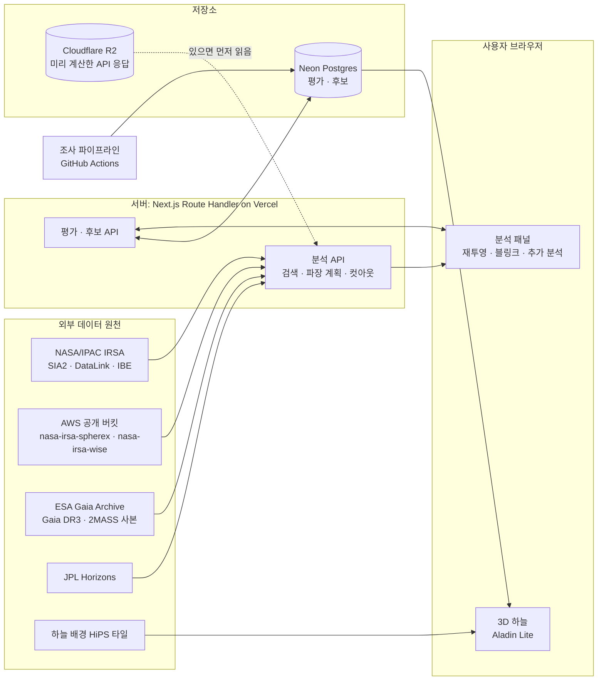

# 3쪽. 아키텍처

## 전체 구조

## 사용자

- **로그인이 없다.** 누구나 주소만으로 들어온다. 이름과 이메일을 받지 않는다.
- 평가할 때만 서버가 무작위 UUID를 `httpOnly` 쿠키(`hd_voter`)로 발급해 브라우저를 구분한다. 쿠키를 지우거나 다른 기기를 쓰면 다시 평가할 수 있다 (알려진 한계).
- 열어 본 곳 기록과 표시 설정은 브라우저에만 저장한다.
- 화면 문구는 영어가 기본이고, 메뉴의 Language에서 한국어를 고를 수 있다.
- PC 브라우저 기준이다. 분석 패널은 좁은 창에서 한 줄로 쌓인다.

## 서버

- **Next.js 16 App Router의 Route Handler가 서버의 전부다.** 별도 백엔드 서버나 Python 서비스가 없다. FITS 읽기, RICE 압축 해제, WCS 계산, 측광을 모두 TypeScript로 한다.
- **Vercel**에 배포한다. `main`에 푸시하면 GitHub Actions가 `pnpm lint`, `pnpm typecheck`를 통과시킨 뒤 프로덕션에 올린다.
- 모든 API는 누구나 부를 수 있는 공개 엔드포인트라서, 입력을 `.strict()` zod 스키마로 검증한다.

### 일을 나누는 방식

| 서버가 하는 일 | 브라우저가 하는 일 |
| --- | --- |
| IRSA에서 그 지점을 덮는 노출 검색 | 받은 컷아웃을 고정 하늘 격자에 재투영 |
| 방문 묶기, 검출기와 기준 파장 고르기 | 방문별 중앙값 합치기, Blink / Difference / Stack 그리기 |
| 원본 파일에서 필요한 픽셀만 읽어 작은 컷아웃으로 전달 | 추가 분석 계산 (점검, 광원 찾기, 3D 운동, 소리) |
| Gaia DR3 별 조회 | 받은 자료는 메모리에만 둠 |

## 데이터: 어디서 받아 어떻게 저장하나

### 받는 곳

| 데이터 | 받는 곳 | 쓰는 곳 |
| --- | --- | --- |
| SPHEREx DR1 노출 목록 | IRSA SIA2 (`spherex_dr1`) | 모든 분석 |
| SPHEREx DR1 픽셀 (L2b) | AWS 공개 버킷 `nasa-irsa-spherex`, HTTP 바이트 범위 읽기 | 모든 분석 |
| 2MASS, WISE, NEOWISE 영상 | IRSA IBE 컷아웃, AWS `nasa-irsa-wise` | Sky Time Machine |
| Gaia DR3 | ESA Gaia Archive (실패 시 IRSA) | 블링크 겹쳐 보기, 여러 분석 |
| 2MASS 점광원 목록 | ESA Gaia Archive의 사본 | 후보 조사 파이프라인 |
| 3I/ATLAS 관측 목록, 거리 | IRSA 전용 목록, JPL Horizons | Comet Breath |
| 하늘 배경 타일 | 지금은 IRSA가 미러한 2MASS 컬러 HiPS | 3D 하늘 (둘러보기 전용) |

- **원본 FITS 파일은 저장하지 않는다.** 한 노출에서 목표 주변 48×48 픽셀만 바이트 범위로 읽는다. 원본은 IRSA 링크로 남긴다.
- **하늘 배경은 둘러보기용이고 분석에는 쓰지 않는다.** 원래는 CDS의 SPHEREx 컬러 HiPS를 쓸 계획이었지만, CDS가 2026-11-09부터 장애라서 2MASS로 대체했다. "This view" 창과 출처 줄에 그렇게 표시한다. (**확인 필요:** 발표 당일 CDS 상태)

### 저장하는 곳

| 저장소 | 저장하는 것 | 쓰기 | 읽기 |
| --- | --- | --- | --- |
| **Neon Postgres** (Prisma 7) | 사용자 평가, 조사 결과와 후보 | 평가 API, 조사 파이프라인 | 서버만 |
| **Cloudflare R2** | 미리 계산한 분석 API 응답 (gzip JSON) | 로컬 서버의 사전 저장 스크립트만 | 프로덕션은 읽기만 |
| **레포의 정적 파일** | 고유운동이 큰 Gaia 별 70,254개 목록, 별자리 선 | 스크립트로 생성 후 커밋 | 브라우저 |
| **브라우저** | 열어 본 곳, 표시 설정, 언어 | 사용자 | 본인만 |

### R2 사전 저장 (결정 #56, 제안 상태)

- IRSA는 느리고 대회 중에도 502 오류가 반복됐다. 그래서 미리 찾아 둔 곳은 응답을 저장해 두고 바로 보여준다.
- **대상:** 테스트 대상 5개, 조사 후보 303개(Known mover 262 + Unidentified 41), 3I/ATLAS.
- **키:** `responses/v1/<API 경로>/<입력의 SHA-256>.json.gz`. 좌표는 URL과 같은 1e-5°로 반올림한다.
- **동작:** 저장된 응답이 있으면 그것을 돌려준다. 없거나 R2가 8초 안에 답하지 않으면 실시간으로 처리한다. R2가 실패해도 요청은 실패하지 않는다.
- **쓰기는 공개 API에서 막았다.** 아무 좌표나 저장되면 누구나 버킷을 채울 수 있기 때문이다. 그래서 임의 좌표는 매번 실시간으로 처리한다.
- 측정: 같은 요청이 8.9초 → 0.28초.
- **확인 필요:** 상태 문서(11/15 16:45)에는 "채우는 중"이고, 프로덕션에서 쓰려면 Vercel에 `R2_*` 환경 변수 4개가 있어야 한다.

## DB 모델

| 모델 | 내용 |
| --- | --- |
| `Rating` | 브라우저 하나가 하늘 칸 하나에 준 현재 평가. (릴리스, 칸, 브라우저) 고유 키. 평가를 바꾸면 그 행을 고친다. 평가 당시 SPHEREx 방문 횟수도 저장 |
| `MotionSurvey` | 조사 실행 1회. 방법, 릴리스, 파이프라인 버전, 기준값 |
| `MotionSurveyPoint` | 조사한 모든 지점. 결과가 0개인 곳과 실패한 곳도 남긴다 |
| `MotionCandidate` | 후보 짝. SPHEREx 위치와 관측 시점, 2MASS 위치와 관측 시점, 이동량, S/N, 분류(`KNOWN_MOVER` / `GAIA_STATIC` / `UNIDENTIFIED`) |

- **평가와 후보를 잇는 열쇠는 HEALPix order 11 칸 번호(약 1.7′)다.** 둘 다 같은 고정 하늘 격자의 칸 번호를 저장해서, 후보가 있는 칸의 평가를 쿼리 하나로 집계한다.
- 움직이는 천체의 좌표는 항상 관측 시점과 함께 저장한다.

## API

| 경로 | 하는 일 |
| --- | --- |
| `GET /api/blink/plan` | 그 지점의 방문, 검출기, 기준 파장, 쓸 노출을 정한 계획 |
| `GET /api/fpl/search` | 그 지점을 덮는 SPHEREx DR1 노출 목록 |
| `GET /api/fpl/frame` | 노출 하나의 원본 픽셀 컷아웃 (블링크, Fake Planet Lab, Sky Sonata, Neighborhood가 공유) |
| `GET /api/fpl/neighbors` | 근처의 밝은 Gaia 별 |
| `GET /api/sky/search` | 미션별(2MASS, WISE, NEOWISE, SPHEREx) 실제 관측 시점 |
| `POST /api/sky/frame` | 한 시점의 영상을 공통 격자로 만든 프레임 |
| `GET /api/sky/gaia` | 고유운동이 큰 Gaia 별 |
| `GET /api/nim/neighbors` | 태양 근처 천체 목록 (Gaia DR3) |
| `GET /api/comet/observations`, `/frame`, `/geometry` | 3I/ATLAS 관측 목록, 프레임, JPL Horizons 거리 |
| `GET` · `PUT /api/ratings` | 내 평가 조회, 평가 생성과 변경 (다른 사이트에서 온 쓰기는 Origin 확인으로 거절) |
| `GET /api/ratings/summary`, `/top` | 여러 지점의 요약(최대 50개), 평가 수 상위 10개 칸 |
| `GET /api/candidates/lookup` | 후보 이름과 2MASS 이름으로 후보 찾기 |

- 평가 전에 집계를 숨기는 규칙은 화면이 아니라 서버에서 지킨다.

## 조사 파이프라인 (기능 A)

- `scripts/motion-survey.ts`를 GitHub Actions 작업 `Motion Survey`로 돌린다 (손으로 실행, 병렬 작업 수와 지점 수 입력).
- 결과는 메타데이터만 JSON Lines로 남긴 뒤 DB에 넣는다. 픽셀은 저장하지 않는다.
- 첫 조사: 실행 1회, 75,756곳, 후보 짝 5,384개.

## 기술 스택

| 영역 | 기술 |
| --- | --- |
| 프레임워크 | Next.js 16 (App Router), React 19, TypeScript 6 |
| 하늘 화면 | Aladin Lite 3.8.2 (TAN 투영 하나로 120°–0.05°) |
| 3D와 그래프 | three.js, React Three Fiber, Recharts |
| 소리 | Web Audio API |
| UI | Tailwind CSS 4, shadcn/ui (Base UI), lucide-react |
| 데이터 요청 | ky, TanStack Query |
| 검증 | zod |
| DB | Prisma 7, PostgreSQL (프로덕션 Neon, 로컬 Docker) |
| 오브젝트 스토리지 | Cloudflare R2 (AWS SDK S3 클라이언트) |
| 배포와 자동화 | Vercel, GitHub Actions |
| 패키지 | pnpm 12, Node.js 24 |

---

근거: `docs/PLAN.md` 7·8·9장, `README.md`, `package.json`, `prisma/models/*.prisma`, `config/env.server.ts`, `app/api/**/route.ts`, `app/api/_server/response-cache.ts`, `.github/workflows/*.yml`, `docs/decisions.md` #25·#33·#35·#56·#57·#59, `docs/memory/status/rreenactt.md`
